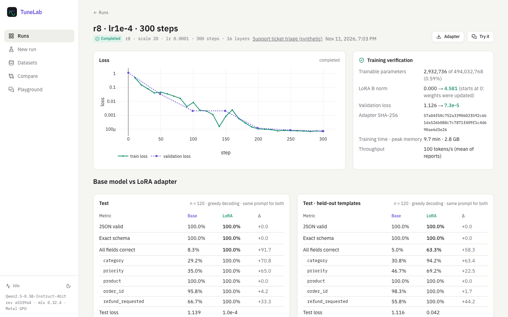
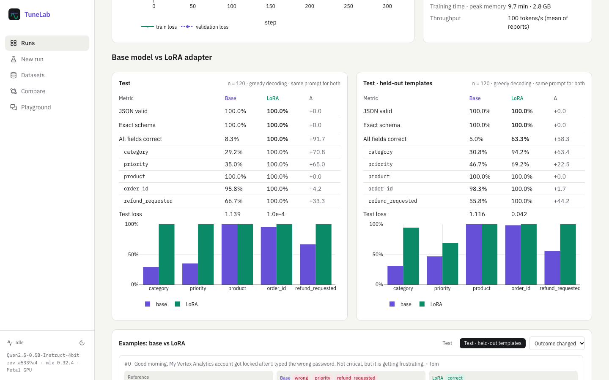
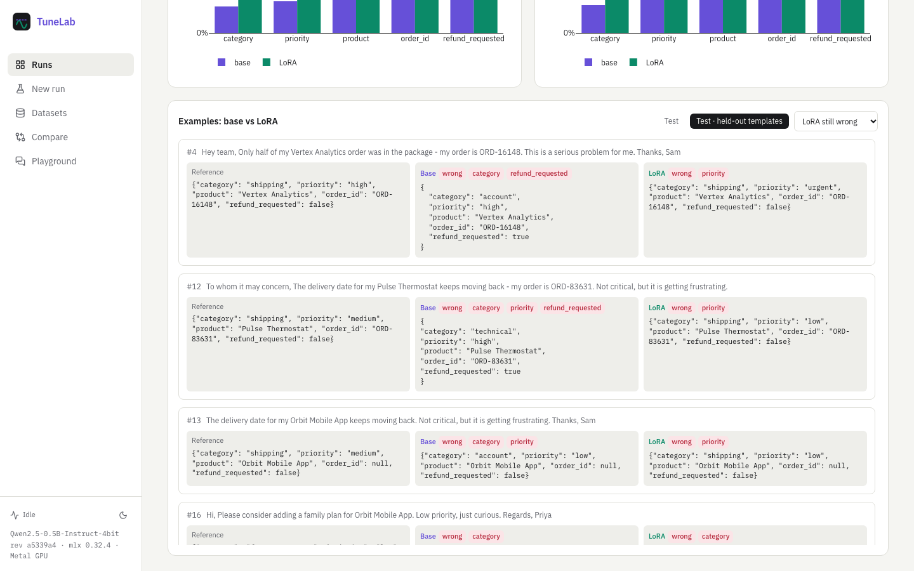
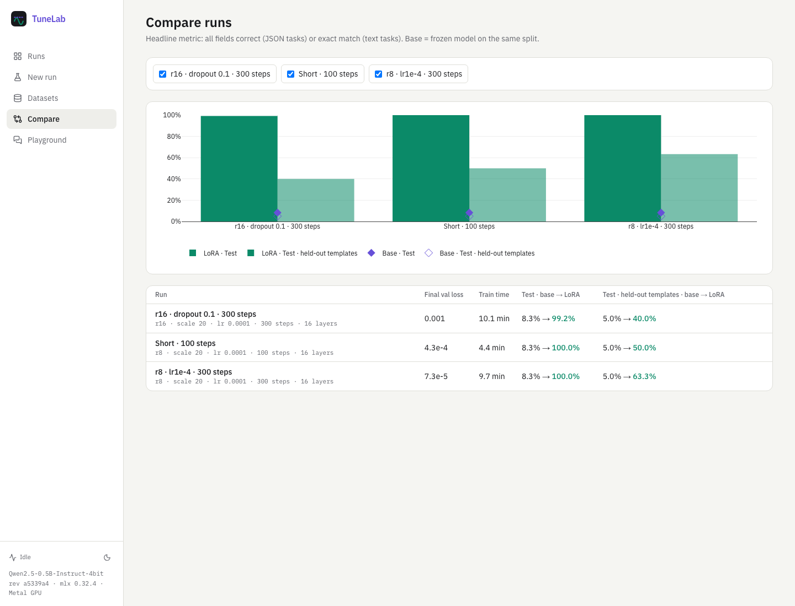
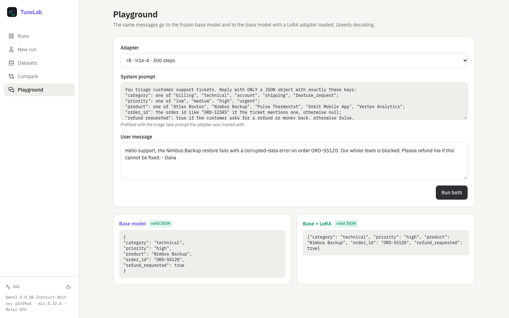

# TuneLab

**Fine-tune a small LLM for real, then prove what changed.** TuneLab trains LoRA adapters with
[MLX-LM](https://github.com/ml-explore/mlx-lm) on Apple Silicon and evaluates each adapter against the
frozen base model on the same data, prompt and decoding, including a test split of phrasings the
adapter never saw.



## What is real here

- **Weights are updated.** Only LoRA matrices are trainable: 2.93M of 494M parameters (0.59%) at rank 8.
  Every run records that `lora_b`'s norm started at 0 (LoRA's no-op init) and ended above 0, plus the
  adapter's SHA-256, loss curves, time and memory. A run that fails the check is marked failed.
- **The comparison is fair.** Base and tuned models get the identical system prompt, test rows and
  greedy decoding; only the adapter file differs. Evaluation reloads the saved adapter from disk.
- **CI trains too.** Unit tests train a tiny random model through the same code, and the Playwright
  journey runs a 10-step LoRA job on the pinned base model (MLX CPU on Linux).

## Results (synthetic support-ticket triage, n = 120 per split)

| Model | Test: all 5 fields correct | Held-out phrasings |
|---|---|---|
| Qwen2.5-0.5B-Instruct-4bit, prompt only | 8.3% | 5.0% |
| + LoRA r8, 300 steps (9.7 min on an M4) | **100.0%** | **63.3%** |
| + LoRA r8, 100 steps | 100.0% | 50.0% |
| + LoRA r16, dropout 0.1, 300 steps | 99.2% | 40.0% |

The adapter fixes the base model's label errors in-distribution, but **priority** only partly
transfers to unseen urgency phrasings (69.2% for the best run; the r16 run, at 40%, falls below the
base model's 46.7%). Analysis, per-field tables and the confusion pattern are in
[docs/RESULTS.md](docs/RESULTS.md); raw exports are in [eval/results.json](eval/results.json). This is a
synthetic task with single seeds, so treat it as evidence that the pipeline works and measures honestly,
not as a claim about real ticket triage.

| | |
|---|---|
|  |  |
|  |  |

## Features

- **Datasets:** a deterministic synthetic task with exact labels and a held-out-template split, or
  upload chat JSONL (line-level validation, hash-based splits, token stats, automatic JSON-field or text scoring).
- **Runs:** validated LoRA hyperparameters and presets. One job at a time runs in a worker
  subprocess with live SSE loss curves, cancel and crash recovery. Finished runs queue baseline and tuned evaluations automatically.
- **Evaluation:** JSON validity, exact schema, all-fields-correct and per-field accuracy (or exact match / token F1),
  teacher-forced loss, and an example browser pairing base and LoRA outputs.
- **Compare** runs; a **playground** that sends the same messages to base and base+LoRA; adapter download.

## Run it

```bash
cd backend && uv sync && uv run tunelab serve                 # API :8114 (Metal GPU on Apple Silicon)
cd frontend && npm ci && npm run dev -- --port 3104            # web :3104
```

Open http://localhost:3104 → Datasets → *Generate dataset* → New run. The pinned base model
(~290 MB) downloads on first use. Headless: `uv run tunelab experiment --out ../eval/exp --configs '{"iters": 300}'`.
`docker compose up --build` also works, but containers have no Apple GPU (MLX CPU backend, slow).

## Stack

MLX 0.32 / mlx-lm 0.32 · Qwen2.5-0.5B-Instruct (4-bit, pinned revision) · FastAPI · SQLAlchemy/SQLite ·
SSE · Next.js 16 · React 19 · TanStack Query · Tailwind 4 · Plotly · pytest · Vitest · Playwright · GitHub Actions.

## Docs

[Training](docs/TRAINING.md) · [Evaluation](docs/EVALUATION.md) · [Results](docs/RESULTS.md) ·
[Datasets](docs/DATASETS.md) · [Architecture](docs/ARCHITECTURE.md) · [API](docs/API.md) ·
[Testing](docs/TESTING.md) · [Deployment](docs/DEPLOYMENT.md) · [Security](docs/SECURITY.md) ·
[Decisions](docs/DECISIONS.md) · [Plan](PLAN.md) · [Progress](PROGRESS.md)
